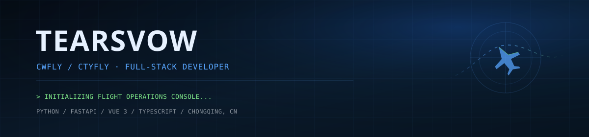

<div align="center">



<code>&gt; SYSTEM ONLINE // CWFLY / CTYFLY // 2026</code>

</div>

## 关于我 / ABOUT

我是 **Tearsvow**，常驻重庆，INTP。  
CWFLY / CTYFLY 全栈开发者，模拟飞行社区维护者。

> 我不是在写页面。  
> 我是在把一堆想法、数据和审美要求，整理成一个能长期运转的系统。

## 当前任务 / CURRENT MISSIONS

```text
[01] CTYFLY   航情 / 航路规划 / 连飞活动 / 虚拟航司 / 经济系统 / ACIS
[02] CWFLY    社区官网 / FSD 连线服务器 / ATC 管制中心 / QQ Bot / Docs
[03] ENGINE   性能优化 / 移动端 / 自动化回归 / 部署可靠性
[04] DOCS     把踩过的坑写成文档和脚本，让下一次少踩一点
```

## 工作流 / WORKFLOW

| 抽象先行 | Bug 嗅觉 | 自动化倾向 |
|---|---|---|
| 先搭结构，再补细节。偶尔结构搭得太认真，最后发现需要重写。 | 看到异常先问为什么，再问怎么修，最后问为什么没有测试。 | 能交给脚本的事，尽量不靠记忆手工重复。 |

## 技术栈 / TECH STACK

<div align="center">


`Python` · `FastAPI` · `Vue 3` · `TypeScript` · `MySQL` · `Docker` · `Nginx`

</div>

## 运行数据 / GITHUB ANALYTICS

<div align="center">


</div>

## 项目 / PROJECTS

| 项目 | 定位 | 入口 |
|---|---|---|
| **CTYFLY** | 航情、航路、连飞活动、虚拟航司、经济系统、ACIS 事件检索 | [ccflysim.cn](https://www.ccflysim.cn) · [源码](https://github.com/yuanshen-123-ui/CTYFLY-WEB) |
| **CWFLY** | 社区官网、FSD 连线服务器、ATC 管制中心、QQ 机器人、文档站 | [cwflysim.cn](https://www.cwflysim.cn) · [WEB](https://github.com/yuanshen-123-ui/CWFLY-WEB) · [FSD](https://github.com/yuanshen-123-ui/CWFLY-FSD) · [ATC](https://github.com/yuanshen-123-ui/CWFLY-ATC) · [BOT](https://github.com/yuanshen-123-ui/CWFLY-BOT) · [DOCS](https://github.com/yuanshen-123-ui/CWFLY-DOCS) |

**支线项目 / SIDE QUESTS**  
[love-memoir](https://github.com/yuanshen-123-ui/love-memoir) · [embroidery-note](https://github.com/yuanshen-123-ui/embroidery-note)

## 通讯频率 / CONTACT

```text
GITHUB   https://github.com/yuanshen-123-ui
BLOG     https://blog.ccflysim.cn/
CWFLY    https://www.cwflysim.cn
CTYFLY   https://www.ccflysim.cn
EMAIL    501827685@qq.com / guichangyang@ccflysim.cn
```

<div align="center">

<sub>保持输入，也保持输出。必要时，先交付，再完美。</sub>

</div>
